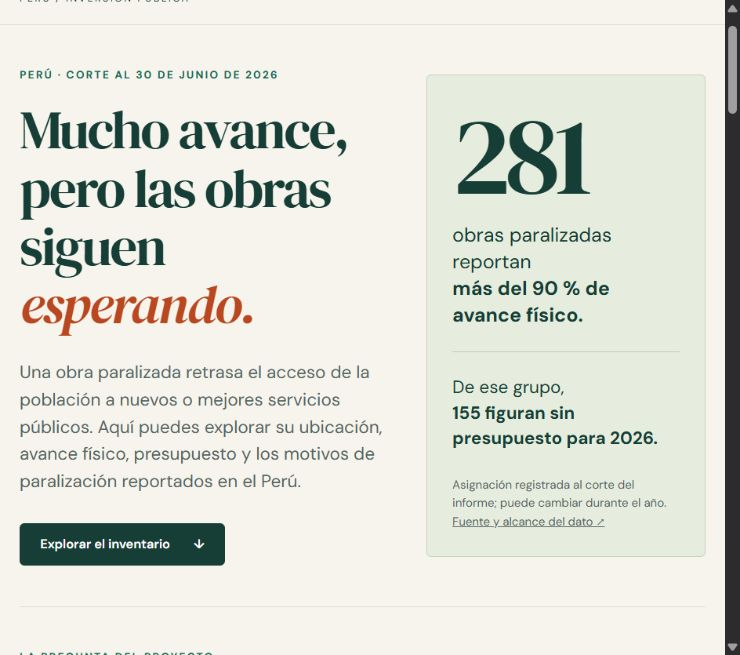
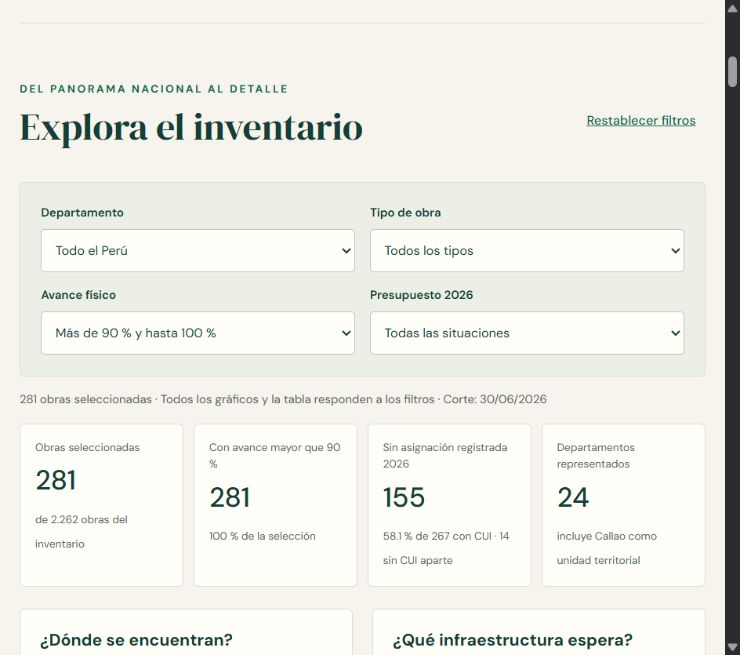

# Obras que esperan

**Autor:** Jose Pablo Navarro Nateros (@bocchienjoyer).

**Pregunta:** ¿Qué caracteriza a las obras públicas paralizadas en el Perú y qué patrones presentan aquellas con mayor avance físico?

Se analiza el inventario de Contraloría con corte al **30 de junio de 2026**: 2.262 obras. El análisis describe su ubicación, tipo, avance y causas reportadas, con atención a las obras que superan el 90 % de avance físico. La paralización posterga la entrega o mejora de infraestructura. El registro no permite medir por sí solo la disponibilidad efectiva de servicios ni los daños sufridos por la población.

**[Explorar el dashboard público](https://obras-que-esperan-peru.fancyperch2.chatgpt.site)**





## Resultados

**281 obras (12,4 %) superan el 90 % de avance físico y figuran paralizadas.** De ellas, 155 con código de inversión no registran presupuesto asignado para 2026. El umbral de avance es estrictamente mayor que 90 % y hasta 100 %, conforme al rango del anexo; tres obras con exactamente 90 % pertenecen al intervalo anterior.

- **23 obras reportan 100 % de avance y siguen clasificadas como paralizadas.** Es una discrepancia que requiere seguimiento; el registro no permite determinar si están operativas ni qué falta para culminar cada caso.
- **58 de las obras de mayor avance se iniciaron en 2015 o antes.** La antigüedad se refiere al inicio reportado, no a años de paralización continua.
- **El incumplimiento de contrato es la causa más reportada entre las obras de mayor avance: 76 casos, frente a 55 que señalan falta de recursos financieros y liquidez.** Son declaraciones de las entidades, no una identificación causal independiente. La situación presupuestaria de 2026 y el motivo de paralización son variables distintas.

Entre las 281 obras, 267 tienen CUI: 155 sin asignación registrada (58,1 %) y 112 con asignación. Otras 14 carecen de CUI; la ausencia de código impide distinguir presupuesto cero de falta de identificación presupuestaria. La distribución por infraestructura también puede explorarse: 79 corresponden a vivienda/construcción/saneamiento y 57 a transportes/comunicaciones (136 de 281, 48,4 %).

De las 281 obras, 23 reportan 100 % de avance. Se conservan porque forman parte del inventario oficial. Al excluirlas, quedan 258 obras: 248 con CUI y 10 sin CUI. Entre las 248 identificadas, 144 (58,1 %) no registran asignación. El resultado es similar al del grupo completo. En todo el inventario, la proporción sin asignación entre obras con CUI es 64,8 %; el grupo de mayor avance no presenta una proporción superior.

## Fuentes y metodología

La fuente principal es el [informe de Contraloría y sus anexos](https://www.gob.pe/institucion/contraloria/informes-publicaciones/8489152-informe-de-obras-paralizadas-en-el-territorio-nacional-a-junio-de-2026), publicado el 17 de agosto de 2026. Los originales descargados y sus enlaces, fechas de recuperación y hashes SHA-256 se conservan en `datos/originales/`. El Anexo 1 contiene los registros analizados; el Anexo 2 documenta servicios de control y no se incorpora a los cálculos de obras.

La unidad de análisis es **una obra identificada por código INFOBRAS**. Se normalizan espacios y se convierten valores numéricos sin inventar datos. «No declarado» y CUI igual a cero se tratan como ausencias. Los ceros monetarios se conservan como valores reportados. Se validan identificadores únicos, límites del avance, correspondencia del rango superior y coherencia entre PIM y su indicador de disponibilidad.

Las frecuencias y porcentajes utilizan denominadores explícitos. El **PIM (Presupuesto Institucional Modificado)** es el presupuesto autorizado para el año, actualizado hasta la fecha consultada; no es dinero gastado ni el costo total de culminación. La tabla 12 de Contraloría incluye obras sin CUI en su grupo sin PIM. Se conserva el cero original y se añade `estado_presupuesto` con tres categorías: con asignación, sin asignación registrada y sin CUI. Las 134 obras sin CUI permanecen en el inventario y se separan de los indicadores presupuestarios. Los costos de obra de INFOBRAS y los costos de inversión de Invierte.pe miden conceptos diferentes: su cociente **no es un sobrecosto**. Una inversión CUI puede agrupar varias obras, por lo que no se suman costos de inversión ni PIM repetidos para producir indicadores monetarios.

La interpretación se apoya en **continuidad de la inversión pública**: sostener recursos y gestión durante varios años para que lo construido pueda cumplir su propósito. La [OCDE (2025)](https://www.oecd.org/en/publications/2025/09/oecd-economic-surveys-peru-2025_d9bfa904/full-report/achieving-strong-growth-and-safeguarding-fiscal-sustainability_000545c6.html) señala que la falta de financiamiento asegurado entre años genera demoras e ineficiencias en Perú. El [Banco Mundial (2025, capítulo 4, párrafos 185 y 189–192)](https://documents1.worldbank.org/curated/en/099030325150510528/pdf/P177645-b964994f-03e4-4ce8-aa59-7642a26b538e.pdf) identifica problemas para proteger recursos de proyectos en marcha frente a proyectos nuevos. Si una obra necesita financiar trabajos pendientes, resolver su financiamiento es una condición para continuarlos; si esos trabajos son indispensables para prestar el servicio, su demora puede postergar el beneficio esperado. La literatura sustenta este mecanismo general, pero el inventario no prueba que explique cada caso.

## Limitaciones

- Se observa un inventario a una fecha determinada. La situación de una obra puede haber cambiado después. Los años de inicio no indican cuántos años estuvo paralizada.
- Hay 54 obras sin avance declarado y 23 con 100 % reportado. Un avance alto no demuestra operatividad ni facilidad para culminar la obra.
- Las causas proceden de lo declarado por las entidades. No son una auditoría causal independiente ni una prueba de corrupción.
- Las comparaciones describen obras paralizadas. No estiman el riesgo de paralización de todas las obras de un territorio o entidad.
- No se dispone de una medición uniforme de personas afectadas, tráfico, interrupciones de servicios o rentabilidad social. Tampoco de costos iniciales y finales comparables para calcular sobrecostos.

## Reproducción

Requiere Python 3.11 o posterior. Desde la raíz del repositorio:

```console
python -m pip install -r tarea_3/requirements.txt
python tarea_3/scripts/obtener_datos.py
python tarea_3/scripts/procesar_datos.py
python tarea_3/scripts/analizar_datos.py
python tarea_3/scripts/preparar_web.py
python -m http.server 8000 --directory tarea_3/web
```

Abrir `http://localhost:8000`. Si ya se dispone de los originales, procesamiento y análisis reproducen las tablas sin conexión. La preparación web descarga la cartografía del MEF únicamente si no está presente. `datos/procesados/calidad.json` registra controles de calidad y `resumen.json` los resultados principales.

El dashboard incluye cuatro indicadores, mapa departamental y gráficos por tipo, avance y causa. Cinco filtros permiten explorar departamento, tipo, avance, presupuesto y año de inicio. La consulta final busca por nombre, entidad o código INFOBRAS y permite descargar la selección en CSV. La cartografía procede del servicio del MEF, atribuido al INEI en sus metadatos, y se utiliza con fines referenciales; se conserva con su fuente en `web/data/`.

El material audiovisual utiliza Python 3.12 en un entorno separado:

```console
python -m pip install -r tarea_3/reel/requirements.txt
python tarea_3/scripts/generar_reel.py
```

Sin narración, este comando reproduce `reel/vista_previa.mp4`, de 60 segundos, con música original y aviso visible de ausencia de voz. La síntesis utiliza otro entorno con `reel/requirements_voz.txt` y una referencia de voz propia mantenida fuera de la carpeta pública. Los créditos están en `reel/recursos/creditos.md`.

Para sintetizar la narración, la referencia de 15–25 segundos y su transcripción exacta se ubican en una carpeta privada. Desde el entorno de voz:

```console
python -m pip install -r tarea_3/reel/requirements_voz.txt
python tarea_3/scripts/generar_narracion.py --referencia .cache/tarea3-voz/referencia.wav --transcripcion .cache/tarea3-voz/referencia.txt --salida .cache/tarea3-voz/salida
```

El modelo Base Qwen3-TTS 0.6B se descarga en la caché privada. Se sintetiza por oraciones para obtener audio, tiempos por escena y subtítulos con el texto pronunciado. Desde el entorno de montaje:

```console
python tarea_3/scripts/generar_reel.py --narracion .cache/tarea3-voz/salida/narracion.wav --tiempos .cache/tarea3-voz/salida/tiempos_escenas.json --subtitulos .cache/tarea3-voz/salida/subtitulos.srt
```

El montaje exige 45–75 segundos y tiempos consecutivos para escenas y subtítulos. La pronunciación y la sincronización se revisan escuchando el resultado. El video incorpora dos capturas del dashboard; sus imágenes originales están en `reel/recursos/dashboard_general.png` y `reel/recursos/dashboard_exploracion.png`.

## Uso de inteligencia artificial

Se utilizó IA para explorar bibliografía, desarrollar el código y apoyar la redacción. Los resultados publicados se calculan a partir de archivos oficiales y se contrastan con el informe y los controles de calidad. Las interpretaciones se limitan a lo que permiten los datos.
